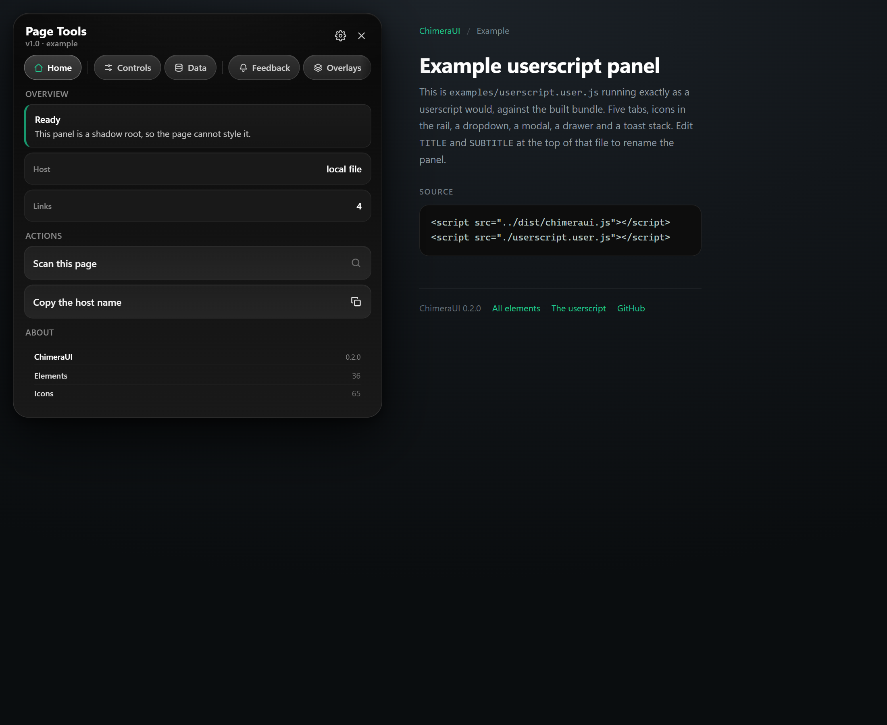
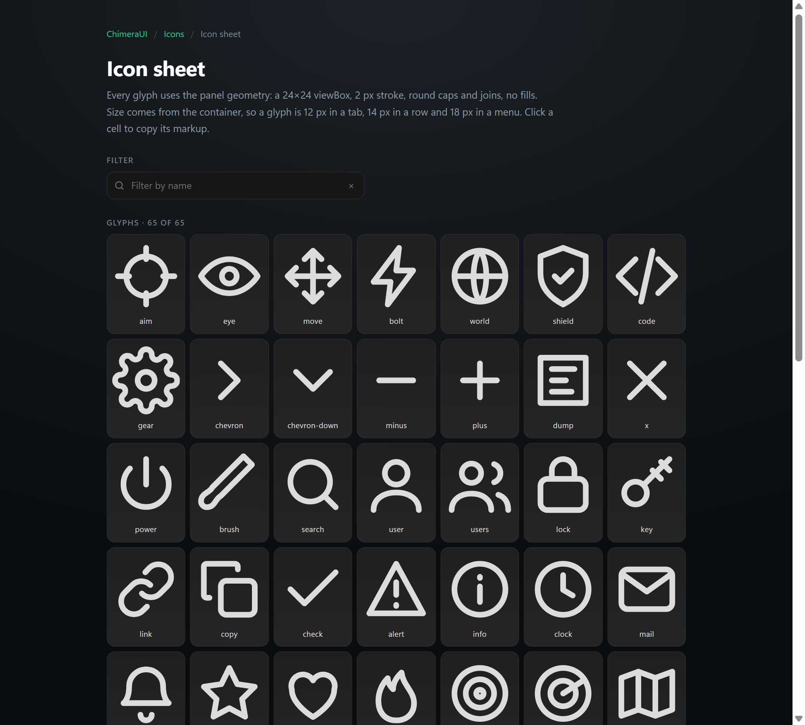
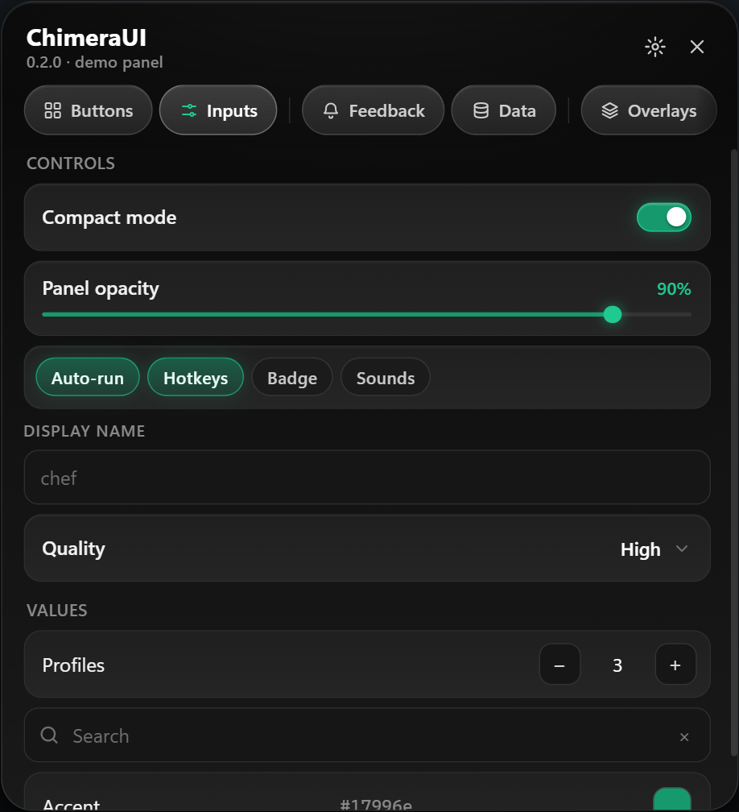
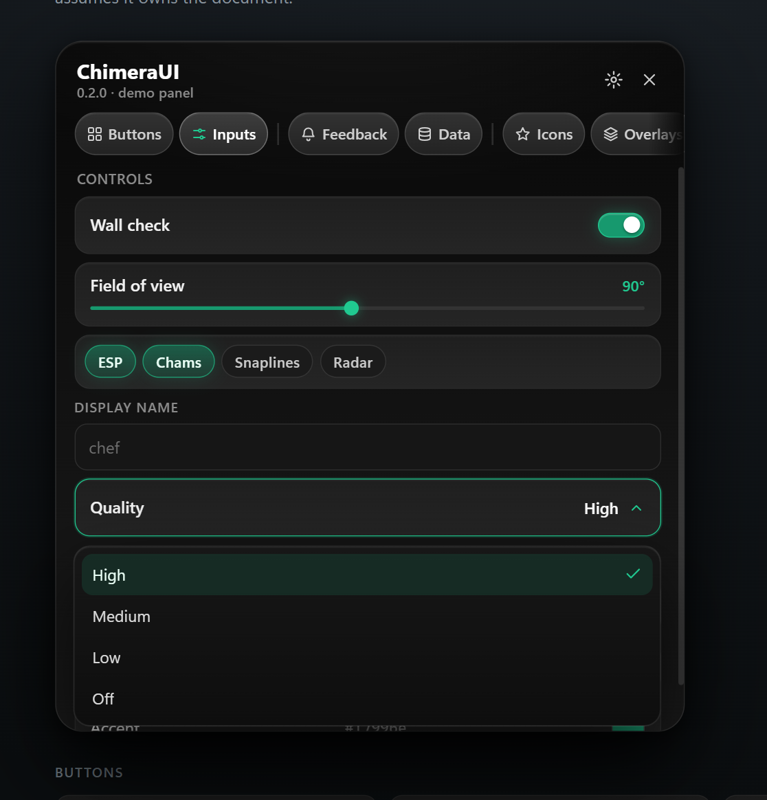
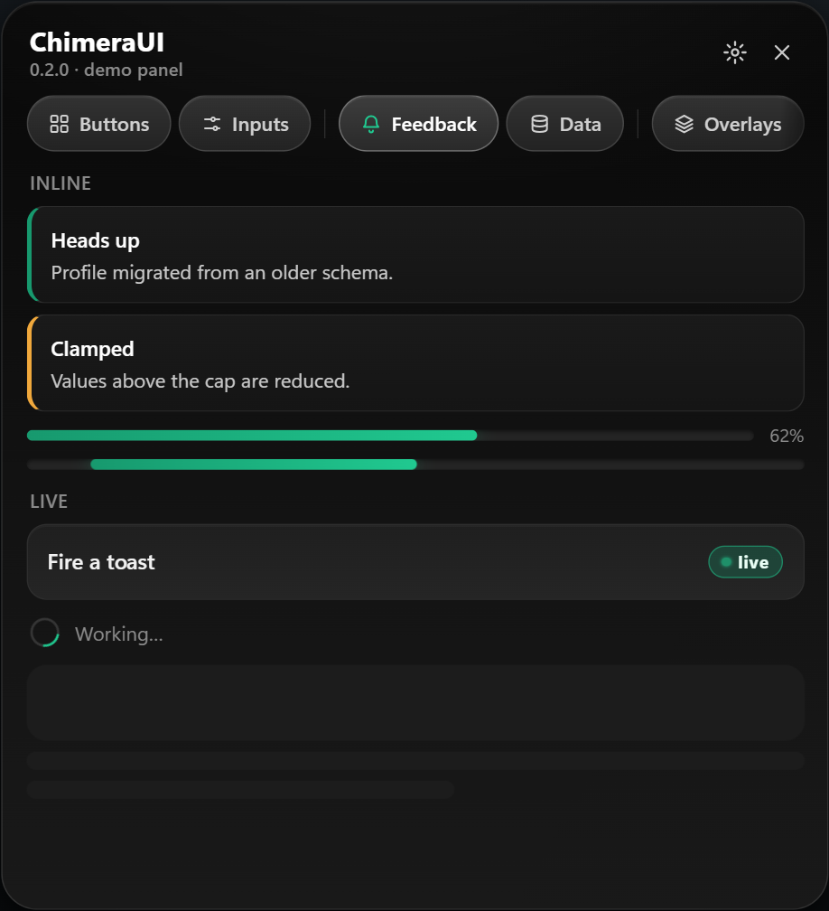
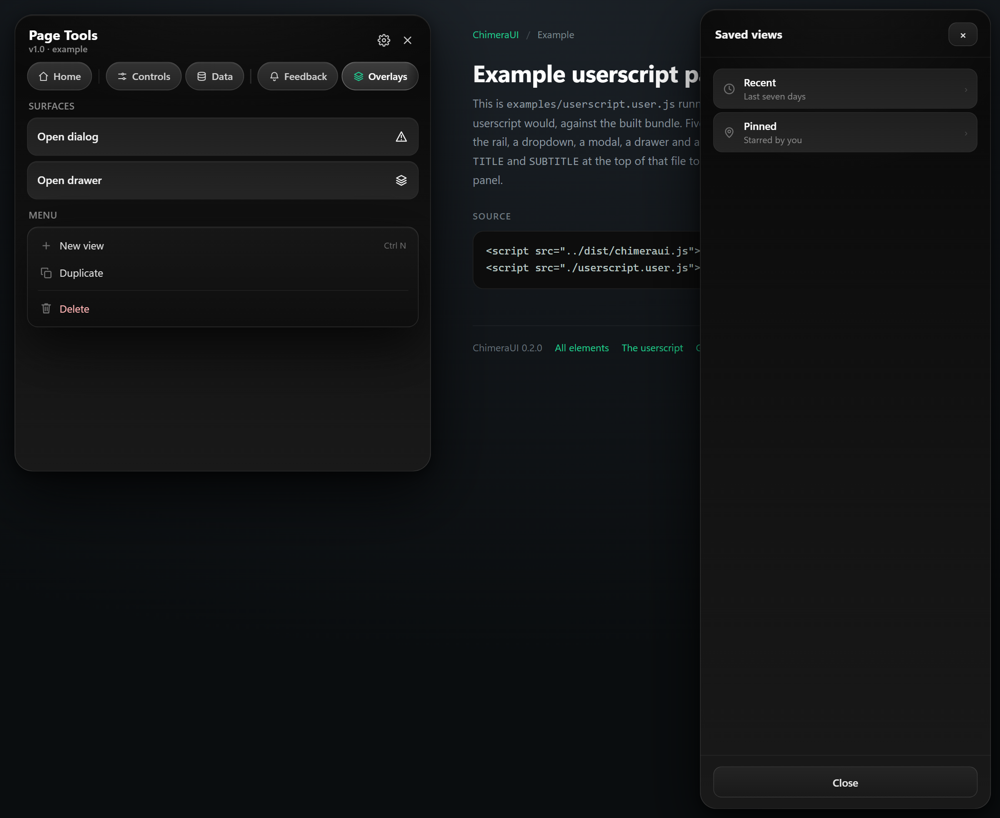
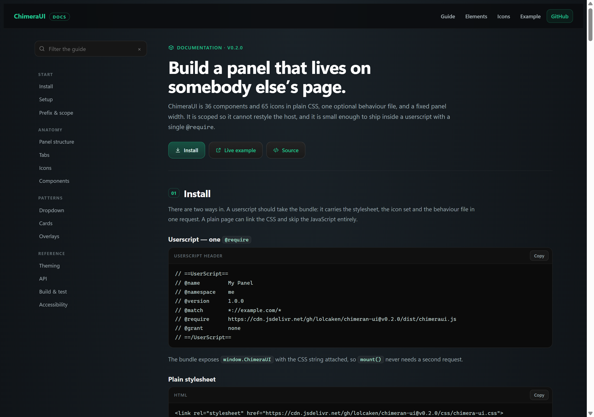

<div align="center">

# ChimeraUI

**A dependency-free UI kit for userscripts.**

37 components · 65 icons · one stylesheet · one behaviour file · shadow-DOM safe

[](./LICENSE)
[](https://github.com/lolcaken/chimeran-ui/releases)
[](https://lolcaken.github.io/chimeran-ui/)
[](./package.json)
[](./tools/check-overflow.mjs)

[Live docs](https://lolcaken.github.io/chimeran-ui/) · [Guide](https://lolcaken.github.io/chimeran-ui/guide.html) · [Elements](#elements) · [Quickstart](#quickstart) · [Tokens](#tokens) · [API](#api) · [Contributing](#contributing)

</div>

---

## What it is

ChimeraUI is a compact panel kit for **userscripts**, extracted from a private tool and opened up. It is built for the one environment browser extensions never handle well: somebody else's page, where your stylesheet must not leak, your z-index must sit above the app, and your panel must never push the host layout around.

- **Scoped by construction** — every rule lives under `n1-*` classes and is designed to be injected into a shadow root. Nothing sets `body`, `html`, or a bare element selector.
- **One import** — `css/chimera-ui.css` pulls the tokens and all 37 component files.
- **Icons included** — 65 glyphs on one stroke geometry, addressable by name from markup or JS.
- **Markup first** — the behaviour file is optional. If you only want the look, drop the CSS and write your own handlers.
- **No overflow** — verified by a Playwright gate on every page, at three viewport widths.
- **No framework, no build step to consume it** — plain CSS and one IIFE.


---

## Quickstart

### As a userscript (recommended)

```js
// ==UserScript==
// @name         My Panel
// @namespace    me
// @version      1.0.0
// @match        *://example.com/*
// @require      https://cdn.jsdelivr.net/gh/lolcaken/chimeran-ui@v0.2.0/dist/chimeraui.js
// @grant        none
// ==/UserScript==

const PANEL = `
<div id="n1-panel" class="n1-root">
  <div class="n1-head">
    <div class="n1-title">My Panel<span class="n1-sub">1.0.0</span></div>
  </div>
  <div class="n1-tabs" data-cn="tabs">
    <button class="n1-tab" role="tab" aria-selected="true" data-cn-tab="main">
      <span class="n1-ic" data-cn-icon="home"></span><span>Main</span>
    </button>
  </div>
  <div class="n1-main"><div class="n1-main-inner"><div class="n1-stage">
    <div class="n1-pane" data-cn-pane="main">
      <button class="n1-toggle on" data-cn="toggle">
        <span class="n1-label">Feature</span>
        <span class="n1-track"><span class="n1-knob"></span></span>
      </button>
    </div>
  </div></div></div>
</div>`;

const { root } = ChimeraUI.mount({
  html: PANEL,
  title: 'My Panel',
  subtitle: 'v1.0.0 · userscript',
});
ChimeraUI.toast(root, { title: 'Loaded', message: 'Press Insert.' });
```

`mount()` creates the fixed host, attaches the shadow root, injects the stylesheet, and runs `attach()` on the result.

### As plain CSS

```html
<link rel="stylesheet" href="https://cdn.jsdelivr.net/gh/lolcaken/chimeran-ui@v0.2.0/css/chimera-ui.css">
<body class="n1-root"> ... </body>
```

### From source

```bash
git clone https://github.com/lolcaken/chimeran-ui
cd chimeran-ui
node build.mjs      # -> dist/chimeraui.js, dist/chimeraui.css
npm test            # overflow gate
```

### A full example

[`examples/userscript.user.js`](examples/userscript.user.js) is a complete, generic panel: Home / Controls / Data / Feedback / Overlays, an icon on every tab, a dropdown, a modal and a drawer. Copy it, change `TITLE` and `SUBTITLE` at the top, and it is your script's UI. [Live preview →](examples/index.html)



---

## Why it is shaped like this

| Decision | Reason |
|---|---|
| `n1-*` prefix on every class | A userscript shares a document with an app it does not control. Prefixed, flat class names cannot collide. |
| Shadow root by default | Host styles cannot reach in; panel styles cannot leak out. `mount()` does it for you. |
| 458 px surface | Fixed width with `max-width:calc(100vw - 20px)`. Wide enough for two columns, narrow enough for a laptop. |
| 410 px scroll pane | The panel never grows past the viewport; the content scrolls instead. |
| Fixed table layout | Long cells ellipsise rather than widening the panel. |
| `min-width:0` on every flex child | The single most common cause of a panel that "mysteriously" grows. |
| One CSS file per element | Audit or ship a single component without dragging the rest. |
| No global selectors | `body`, `html`, `*` are untouched. The kit cannot restyle the host page. |

---

## Elements

Every component has a standalone page with states, markup, and a live demo. The icon sheet is separate and covers all 65 glyphs.

### Icons

65 glyphs in one stroke language: 24×24 viewBox, 2 px stroke, round caps, no fills. Use them in tab rails, menu rows, list rows, empty states — anywhere a `.n1-ic` container fits.

```html
<span class="n1-ic" data-cn-icon="gear"></span>
```



[Open the icon sheet →](elements/icons.html)

### Buttons

| | |
|---|---|
| [Button](elements/button.html) | 42 px row, primary / danger / ghost / small / disabled / running |
| [Icon button](elements/icon-button.html) | 24 px square, 14 px glyph, close variant |
| [Destructive row](elements/bypass.html) | The one red surface, 38 px, glow while active |


### Inputs

| | |
|---|---|
| [Toggle](elements/toggle.html) | 34 × 18 track, 12 px knob |
| [Slider](elements/slider.html) | Range with live readout and painted fill |
| [Select](elements/select.html) | Native select, panel geometry |
| [Dropdown](elements/dropdown.html) | Custom list, animated, flips and escapes clipping |
| [Chips](elements/chips.html) | Single or multi select, wraps |
| [Input](elements/input.html) | 34 px field, accent focus |
| [Textarea](elements/textarea.html) | Multi-line, vertical resize |
| [Checkbox](elements/checkbox.html) | 16 px box, CSS tick |
| [Radio](elements/radio.html) | 16 px ring, accent dot |
| [Stepper](elements/stepper.html) | Bounded numeric control |
| [Search](elements/search.html) | Field with glyph and clear |
| [Keybind](elements/keybind.html) | Captures the next key |
| [Colour](elements/color.html) | Native colour input in a swatch |




### Feedback

| | |
|---|---|
| [Toast](elements/toast.html) | Fixed stack, timed bar, info / warn / error |
| [Alert](elements/alert.html) | Inline, same left-bar language |
| [Progress](elements/progress.html) | Determinate and indeterminate |
| [Spinner](elements/spinner.html) | 16 px and 24 px |
| [Skeleton](elements/skeleton.html) | Shimmer placeholders |
| [Badge](elements/badge.html) | Count and status pills |
| [Tooltip](elements/tooltip.html) | CSS-only on `data-tip` |




### Data

| | |
|---|---|
| [Card](elements/card.html) | Collapsible group with a chevron head |
| [Stat](elements/stat.html) | Read-only label/value row |
| [Spec list](elements/spec.html) | Dense metadata rows |
| [Table](elements/table.html) | Fixed layout, ellipsis cells |
| [List row](elements/list.html) | Icon, two lines, meta, chevron |
| [Avatar](elements/avatar.html) | 26 px initial patch |
| [Keyboard cap](elements/kbd.html) | Inline `<kbd>` styling |
| [Code block](elements/code.html) | Monospace surface |
| [Divider](elements/divider.html) | Hairline, optional label |
| [Empty state](elements/empty.html) | Dashed frame, one action |


### Overlays

| | |
|---|---|
| [Modal](elements/modal.html) | Scrim + 330 px dialog |
| [Drawer](elements/drawer.html) | Floating right sheet, 320 px, 18 px radius |
| [Context menu](elements/menu.html) | 180–220 px floating list |
| [Popover](elements/popover.html) | 250 px anchored panel |




---

## Tokens

Declared once on `.n1-root`. Nothing in the kit hard-codes a colour.

| Token | Value | Used for |
|---|---|---|
| `--n1-window` | `#0b0b0b` | Panel base |
| `--n1-el` / `--n1-el2` | `#1f1f1f` / `#252525` | Row gradient |
| `--n1-stroke` | `#2e2e2e` | Idle border |
| `--n1-stroke-hover` | `#414141` | Hover border |
| `--n1-text` | `#f2f2f2` | Body copy |
| `--n1-dim` | `#8a8a8a` | Secondary copy |
| `--n1-faint` | `#6f6f6f` | Meta, icons |
| `--n1-accent` | `#17996e` | Fill, toggle on |
| `--n1-accent-edge` | `#20c990` | Focus, glow, values |
| `--n1-error` | `#f04b4b` | Destructive |
| `--n1-warn` | `#f0a83c` | Capture, warnings |

Type is `12px/1.35 "Builder Sans","Segoe UI Variable Text","Segoe UI",system-ui,sans-serif`.

---

## API

`window.ChimeraUI` exposes these entry points.

### `mount(opts)`

```ts
mount({
  html?: string;      // panel markup
  css?: string;       // defaults to the bundled stylesheet
  id?: string;        // host id
  mode?: 'open' | 'closed';
  parent?: HTMLElement;
  title?: string;     // rewrites .n1-title
  subtitle?: string;  // rewrites .n1-sub
}): { host: HTMLElement, root: ShadowRoot }
```

Creates a fixed, full-viewport, `pointer-events:none` host, attaches a shadow root, injects styles and markup, appends to `parent` (default `document.body`), then calls `attach(root)`.

### `title(root, title, subtitle?)`

Rewrites the panel head after mount. Pass `''` for the subtitle to remove the line; omit the argument to leave it alone.

```js
ChimeraUI.title(root, 'Page Tools', 'v1.2 · nightly');
```

### `icons`

```js
ChimeraUI.iconNames          // ['aim', 'eye', 'move', ...]
ChimeraUI.svg('gear')        // '<svg …>' string
ChimeraUI.icon('gear')       // <span class="n1-ic"> with the svg inside
```

Markup can skip JS entirely: `<span class="n1-ic" data-cn-icon="gear"></span>` is hydrated by `attach()`.

### `attach(root)`

Wires every `data-cn-*` behaviour inside `root`. Idempotent. Call it after you inject markup into an existing shadow root.

### `toast(root, opts)`

```ts
toast(root, { title: 'Saved', message: 'Written.', type: 'info' | 'warn' | 'error', duration: 4200 })
```

Creates `.n1-toasts` on demand and returns the toast node.

### `tabs(root, box)`

The tab controller used by `attach()`, exported for manual wiring.

Each tab carries its own icon and label:

```html
<button class="n1-tab" role="tab" data-cn-tab="logs" data-cn-sep>
  <span class="n1-ic" data-cn-icon="terminal"></span><span>Logs</span>
</button>
```

`data-cn-sep` draws a divider before that tab. The active glyph reads `--tab-accent` (defaults to the accent edge), so a single tab can be tinted inline: `style="--tab-accent:#f0a83c"`. The rail grows every tab to fill the width, and scrolls by wheel or drag once they no longer fit.

### Data attributes

| Attribute | On | Effect |
|---|---|---|
| `data-cn="tabs"` | tab rail | Arrow/Home/End navigation, `aria-selected`, pane switching |
| `data-cn-tab` / `data-cn-pane` | tab / pane | Matching pair |
| `data-cn-sep` | tab | Draws a divider before that tab |
| `data-cn-icon` | `.n1-ic` | Fills the span with that glyph |
| `data-cn="select"` | `.n1-dd` | Wires the custom dropdown; value lands in `data-value` |
| `data-cn="toggle"` | button | Flips `.on` and `aria-pressed` |
| `data-cn="stepper"` | row | Bounds from `data-cn-min/max/step` |
| `data-cn-open="modal"` / `"drawer"` | any | Opens the first matching overlay |
| `data-cn-close` | any | Closes the containing overlay |
| `data-cn-toast`, `data-cn-title`, `data-cn-msg`, `data-cn-type` | any | Fires a toast |
| `data-cn-copy` | any | Copies a selector's text, or its own |
| `data-cn-multi="true"` | `.n1-chips` | Multi-select |
| `data-cn-unit` / `data-cn-dec` | `.n1-slider` | Readout formatting |

Events: `cn:change`, `cn:tab`, `cn:open`, `cn:close` — all bubbling `CustomEvent`s.

---

## Accessibility

- Tabs are `role="tab"` with roving `tabindex` and `aria-selected`; panes are labelled by their tab.
- Toggles expose `aria-pressed`.
- Modals set `aria-modal`, move focus in, close on Escape and scrim click.
- Focus is visible on every interactive element (`:focus-visible`, accent ring).
- `prefers-reduced-motion: reduce` disables every animation and transition in the kit.
- Colour is never the only signal: badges carry text, alerts carry a heading.

---

## The overflow gate

`npm test` runs `tools/check-overflow.mjs`, which loads every page and fails on:

1. any horizontal document overflow (`scrollWidth > clientWidth`),
2. any block whose border box escapes the content column.

It runs at 320, 458 and 1280 px. A component that grows its parent does not merge.

---

## Docs

The full guide covers install, setup, the `n1-` prefix, panel anatomy, tabs, icons, every component, the dropdown and card patterns, tokens, the API, and the publish steps.

<a href="https://lolcaken.github.io/chimeran-ui/guide.html"></a>

- [Guide](https://lolcaken.github.io/chimeran-ui/guide.html) — long form, with copyable snippets.
- [Elements](https://lolcaken.github.io/chimeran-ui/) — the live panel and all 37 element pages.
- [Example](https://lolcaken.github.io/chimeran-ui/examples/index.html) — the userscript panel running in a mock host.

---

## Contributing

Read [CONTRIBUTING.md](./CONTRIBUTING.md). New components must reuse the token set, pass the overflow gate, and ship a page under `elements/`. No new colours.

---

## License

MIT © 2026 [lolcaken](https://github.com/lolcaken)
